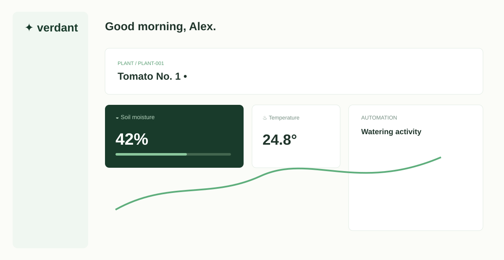
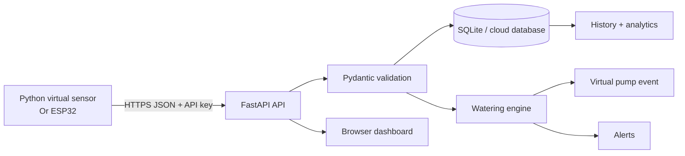

# Verdant Cloud Plant Care

A professional, hardware-free IoT cloud project that monitors a virtual plant, stores time-series sensor readings, automates watering, and exposes a live dashboard. It is designed to run locally on a student laptop and can later accept ESP32 readings without changing the cloud-facing contract.



## Why this project

Manual watering is inconsistent and makes it difficult to see whether a plant is improving. Verdant demonstrates the same cloud and IoT patterns used in smart agriculture: a sensor node publishes readings, an API validates and stores them, an automation engine makes a threshold-based decision, and a dashboard gives a person remote visibility and control.

## Architecture



**Data flow:** the simulator changes soil moisture gradually and posts a reading every five seconds. The API creates the device, stores the reading, updates `last_seen`, checks alerts, and invokes the watering engine. When soil is below the configurable threshold, a watering event is stored, and the simulator increases moisture on the next cycle. The UI polls the overview endpoint every five seconds.

## Features

- Realistic virtual sensor: gradual soil drying, temperature and humidity drift, day/night light curve.
- FastAPI REST API with validation and device API-key support.
- SQLite persistence with indexed readings, watering events, devices, and alerts.
- Automatic watering with threshold, water-tank guard, auto-water toggle, and cooldown.
- Manual watering control and threshold editing from the dashboard.
- Responsive dashboard with live metrics, history chart, activity timeline, and alerts.
- Offline simulator mode and retry logging.
- Pytest API coverage for ingestion, validation, automation, and manual watering.
- Optional ESP32 integration contract documented below.

## Project structure

```text
backend/                 FastAPI application, models, and SQLite access
  app.py                 REST endpoints and business orchestration
  database.py            Schema, indexes, and connection helper
  models.py              Request validation models
automation.py            Watering decision and cooldown logic
sensor_simulator/        Hardware-free virtual IoT device
frontend/                Served dashboard (HTML/CSS/JavaScript)
tests/                   Automated API tests
docs/                    Architecture and proof assets
data/                    Runtime database files (ignored by Git)
requirements.txt         Python dependencies
.env.example             Safe configuration template
```

## Run locally

Requires Python 3.11+.

```powershell
py -m venv .venv
.\.venv\Scripts\Activate.ps1
pip install -r requirements.txt
$env:DEVICE_API_KEY = "demo-device-key"
uvicorn backend.app:app --reload
```

Open http://127.0.0.1:8000. In a second terminal:

```powershell
.\.venv\Scripts\Activate.ps1
python sensor_simulator/simulator.py --interval 5
```

Watch the soil moisture decrease. At the configured threshold, the API creates an automatic watering event and the simulated plant moisture rises. Run tests with:

```powershell
pytest -q
```

## REST API

| Method | Endpoint | Purpose |
|---|---|---|
| GET | `/api/health` | Health check |
| POST | `/api/sensors/data` | Validate and ingest a sensor reading |
| GET | `/api/devices` | List devices |
| GET | `/api/devices/{id}/overview` | Latest reading, history, events, alerts |
| PUT | `/api/devices/{id}/threshold` | Update moisture threshold |
| PUT | `/api/devices/{id}/automation?enabled=true` | Toggle automatic watering |
| POST | `/api/devices/{id}/water` | Queue manual watering |
| POST | `/api/alerts/{id}/acknowledge` | Acknowledge an alert |

Example reading:

```json
{
  "device_id": "PLANT-001",
  "soil_moisture": 32,
  "temperature": 24.8,
  "humidity": 61,
  "light_level": 72,
  "water_tank_level": 82
}
```

## Cloud deployment path

The local API is intentionally cloud-portable. Deploy the frontend as static files on Firebase Hosting, Netlify, or S3/CloudFront. Deploy the FastAPI service to Render, Railway, Fly.io, or Google Cloud Run. Replace SQLite with PostgreSQL, Firestore, DynamoDB, or a time-series database when multiple users or devices require managed durability. Add Firebase Auth or an OIDC provider for user identity, and keep device API keys in a secret manager.

Enterprise mapping: AWS IoT Core/API Gateway -> Lambda -> DynamoDB/Timestream -> SNS; Azure IoT Hub -> Functions -> Cosmos DB -> Notification Hubs; Google Cloud IoT-style MQTT gateway -> Cloud Run/Functions -> Firestore/BigQuery -> Pub/Sub.

## Security notes

The demo key is for local simulation only. A real deployment should use HTTPS, per-device credentials, rotated secrets, authenticated users, ownership checks, rate limiting, input validation, audit logs, and a private actuator command path. Never expose a pump-control endpoint without authorization.

## Optional ESP32 version

Keep the same `POST /api/sensors/data` payload and send the `x-api-key` header from firmware. Read a capacitive soil sensor on an ADC pin, a DHT22 for temperature/humidity, and drive a low-voltage pump through a relay or MOSFET. Use a separate DC pump supply, common ground, and a flyback diode for a MOSFET circuit. Never use mains voltage in a student prototype. The cloud architecture remains the same; only the sensor publisher changes.

## GitHub proof strategy

Recommended commits: `Initialize Verdant project`, `Add virtual IoT simulator`, `Implement sensor ingestion API`, `Add watering automation`, `Build live dashboard`, `Add API tests`, `Document architecture and deployment`.

```powershell
git init
git add .
git commit -m "Initialize Verdant cloud plant care project"
git branch -M main
git remote add origin https://github.com/YOUR_USERNAME/Cloud-Connected-Smart-Plant-Care.git
git push -u origin main
```

## Portfolio summary

**Resume bullet:** Built a cloud-connected smart irrigation platform with FastAPI, SQLite, a realistic Python IoT simulator, automated threshold watering, alerts, and a responsive real-time dashboard; added validation, retries, cooldown protection, and API tests.

**Skills:** Python, FastAPI, REST, SQLite, time-series data, IoT simulation, automation, cloud architecture, frontend engineering, testing, security, Git/GitHub.

## Limitations and next steps

This demo uses polling and SQLite to remain simple and free. Production evolution includes WebSockets or Firebase realtime listeners, managed database storage, background queues, authentication, push notifications, multi-tenant authorization, and real hardware command acknowledgement.
